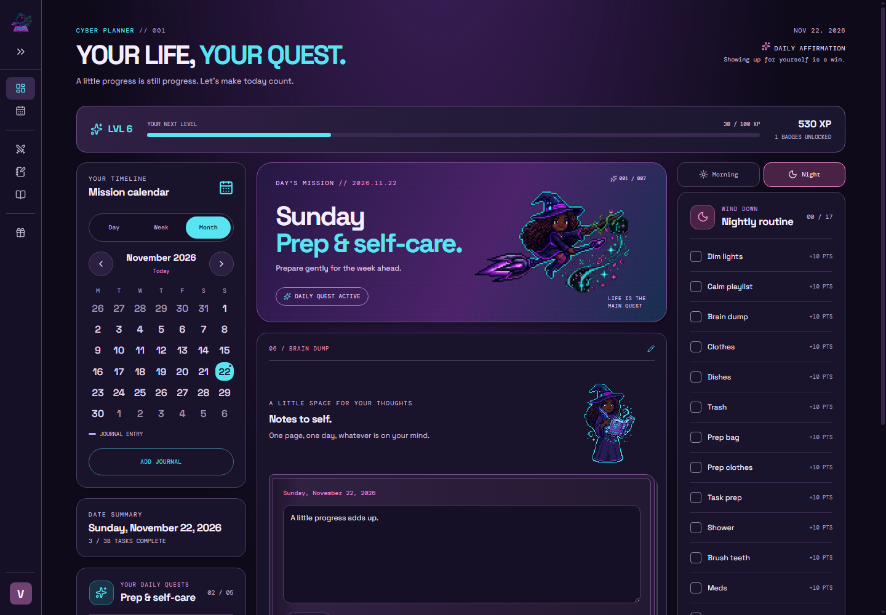
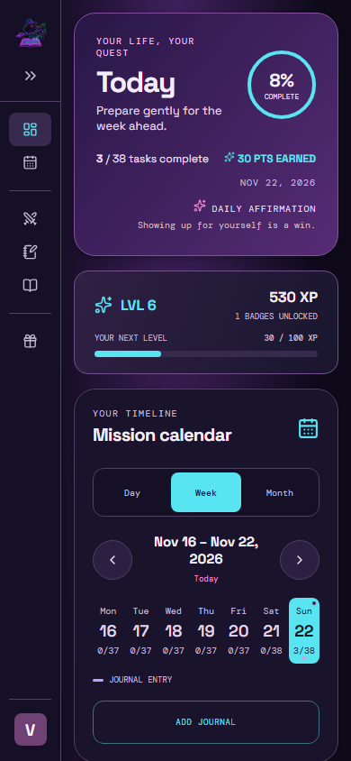
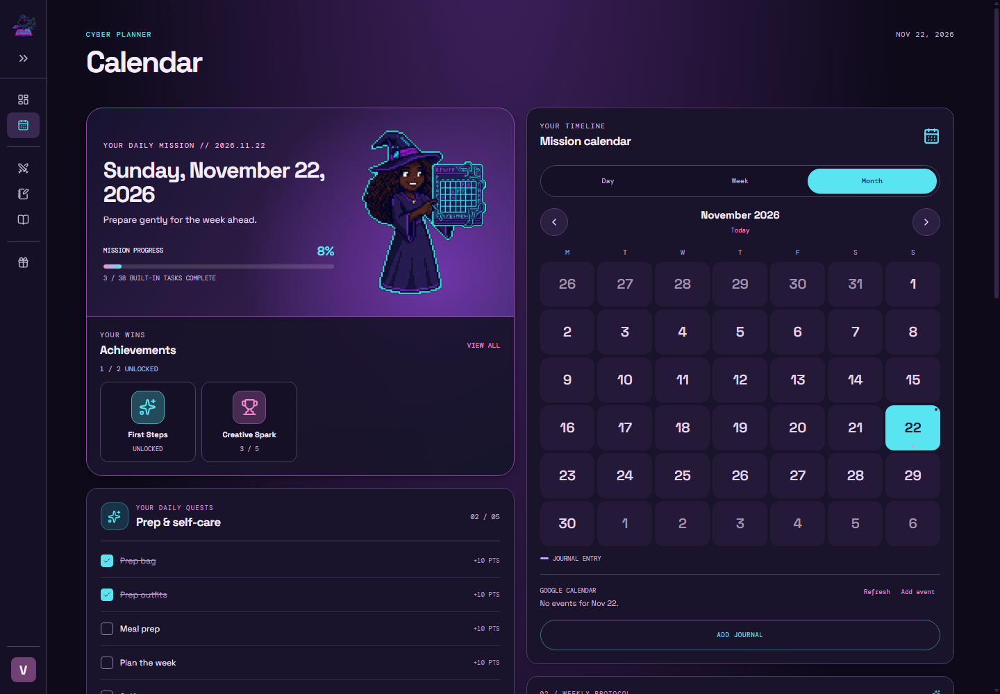
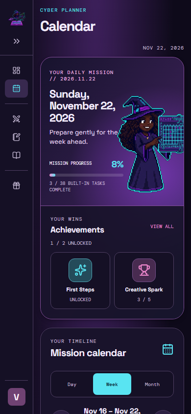
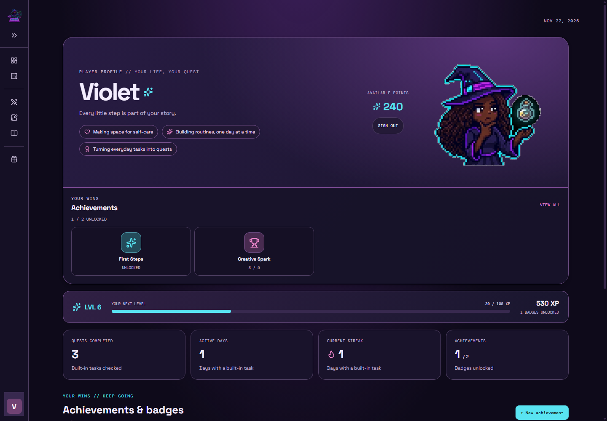
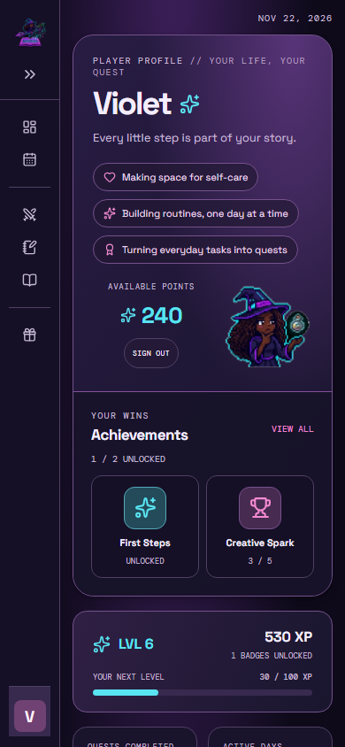
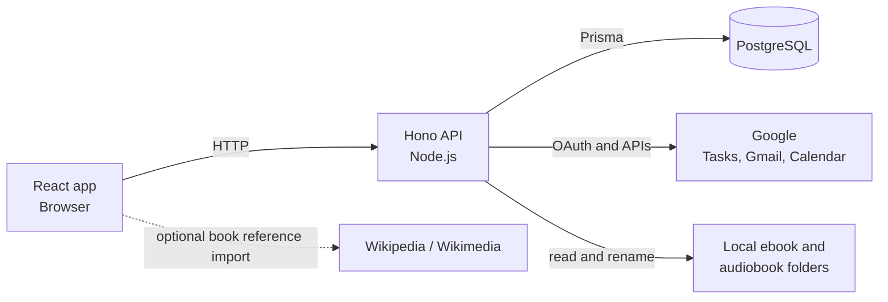

# CyberPlanner

**Your life, your quest.**

A personal planner that turns routines and everyday tasks into quests. Plan your day, earn points, track achievements, and make time for the things you enjoy.

[Get started](docs/setup.md) · [Using CyberPlanner](docs/guide.md) · [Architecture & models](docs/models.md)

## What you can do

- **Plan your day:** track daily quests, morning and night routines, and journal entries.
- **See your schedule:** browse a calendar and connect Google Calendar, Tasks, and Gmail follow-ups.
- **Celebrate progress:** earn points, XP, and achievements, and redeem rewards in the shop.
- **Build your library:** read EPUBs and PDFs or listen to M4B audiobooks from local folders.

CyberPlanner is designed for **one Google account**. It stores planner data and an encrypted Google refresh token in PostgreSQL; Gmail message bodies are not stored.

## A look inside

The screenshots show fictional sample data, captured in Chrome at desktop and mobile sizes.

### Dashboard




### Calendar




### Profile




## Get started

You'll need Node.js 22.22 or newer, PostgreSQL, and a Google Cloud project. The [setup guide](docs/setup.md) walks through the database, Google OAuth, and secrets.

Once configured:

```powershell
npm install
npm run db:migrate
npm run dev
```

Open [localhost:5173](http://localhost:5173) and sign in with the configured Google account.

## How it fits together



The [architecture and models guide](docs/models.md) explains the layers, request flow, storage, and database models.

## Tech stack

| Area | Technology |
| --- | --- |
| Interface | React, React Router, TypeScript, Vite, Bootstrap 5, Sass |
| Journal editor | BlockNote |
| Server | Node.js, Hono |
| Data | PostgreSQL, Prisma |
| Integrations | Google OAuth, Tasks, Gmail, Calendar |
| Library | React Reader / EPUB.js, PDF.js, music-metadata |

## Useful commands

| Command | Purpose |
| --- | --- |
| `npm run dev` | Run the API and development client. |
| `npm run build` / `npm run start` | Build and serve the production app. |
| `npm run db:migrate` | Apply committed database migrations. |
| `npm run db:studio` | Browse the database with Prisma Studio. |
| `npm run typecheck` | Check TypeScript. |
| `npm run lint:hooks` | Check React hook rules and dependencies. |
| `npm run test:server`, `npm run test:profile`, `npm run test:books` | Run focused test suites. |
| `npm run test:book-data` | Run book database and API integration tests against a disposable migrated `TEST_DATABASE_URL`. |
| `npm run test:database` | Run integration tests against a separate, empty, disposable database in `TEST_DATABASE_URL`. |
| `npm run backup:books`, `npm run backup:audible` | Back up ebook or audiobook files (requires 7-Zip). |

For details on backups, reading, rewards, and calendar behavior, see the [user guide](docs/guide.md).
For deployment and OAuth configuration, see the [setup guide](docs/setup.md).
For a disposable test database and Bash test commands, see
[test database setup](docs/setup.md#set-up-a-disposable-test-database).
For endpoint behavior and request formats, see the [API reference](docs/api.md).
