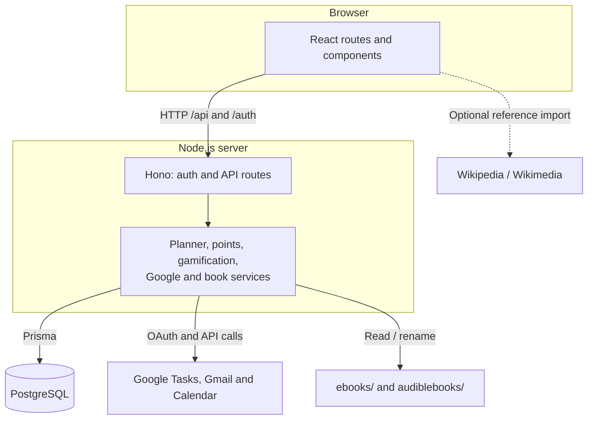
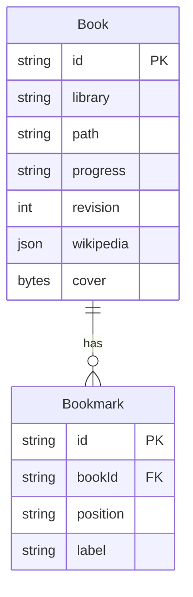

# Architecture and models

This guide maps the source code and data models. For environment configuration, start with the [setup guide](setup.md).

## System overview

In development, Vite serves the browser app and proxies `/api` and `/auth` to the server. In production, the Hono server also serves the built client. Google Calendar events are loaded live rather than stored in PostgreSQL. Wikipedia and Wikimedia requests are made by the browser only when importing a selected book reference; the resulting text and optional cover are saved through the API.

## Source organization

| Location | Responsibility |
| --- | --- |
| [`src/main.tsx`](../src/main.tsx), [`src/App.tsx`](../src/App.tsx), [`src/routes/router.tsx`](../src/routes/router.tsx) | Browser entry point, app composition, and React Router configuration. |
| [`src/layouts/planner-layout.tsx`](../src/layouts/planner-layout.tsx), [`src/pages/`](../src/pages/) | Shared planner shell and thin route-level views. |
| [`src/features/`](../src/features/) | Domain-specific UI, hooks, and services organized by feature. |
| [`src/assets/`](../src/assets/) | Global styles and browser images. |
| [`server/index.ts`](../server/index.ts), [`server/app.ts`](../server/app.ts) | HTTP entry point, middleware installation, router mounting, authentication, and static serving. |
| [`server/planner/`](../server/planner/) | Combined page assembly and thin legacy action dispatch. |
| [`server/books/`](../server/books/) | Book library, metadata, bookmarks, saved references, and book API routes. |
| [`server/gamification/`](../server/gamification/) | Quest and achievement operations and routes. |
| [`server/points/`](../server/points/) | Points ledger, reward redemption, and points/reward routes. |
| [`server/journals/`](../server/journals/) | Journal CRUD routes and database operations. |
| [`server/routines/`](../server/routines/) | Routine routes, definitions, assignment rules, completions, and kind changes. |
| [`server/http.ts`](../server/http.ts) | Shared sign-in, no-store, and server-error handling for API routes. |
| [`server/auth/`](../server/auth/), [`server/google/`](../server/google/) | Session and OAuth handling; Google Tasks, Gmail, Calendar integration, and calendar routes. |
| [`server/db/`](../server/db/) | Prisma client and database helpers. |
| [`shared/planner/`](../shared/planner/) | Types, task and reward definitions, validation, and utilities used by client and server. |
| [`prisma/schema.prisma`](../prisma/schema.prisma), [`prisma/migrations/`](../prisma/migrations/) | Persistent schema and committed database migrations. |
| [`tests/`](../tests/) | Unit, server, and database integration tests. |

The client uses browser APIs; server modules run in Node.js. The Vite configuration prevents the client from importing server modules. Shared planner code is used on both sides.

## Typical request flow

1. React Router's loader requests `/api/planner` for the selected date.
2. The Hono route calls `getPlannerPage`, which checks configuration and the signed-in session.
3. Planner, points, and gamification services assemble the response from PostgreSQL.
4. Journal CRUD, routine changes, and task completions use their resource
   endpoints. Remaining actions are posted to `/api/planner` and dispatched to
   the same underlying services. Calendar and book endpoints have their own routes.

The journal page reads saved dates and entry content through its own GET
endpoints, while the shared planner shell still uses the combined loader. See
the [refactor plan](planner-refactor-plan.md) for the CRUD learning slice and
remaining migrations.

Google sign-in uses `/auth/google` and `/auth/callback`; the server stores an encrypted refresh token and uses it for Google API calls. Only the configured Google account can sign in.

## Data models

The [Prisma schema](../prisma/schema.prisma) is the source of truth for fields, keys, and indexes.
A **model** describes the shape of stored data; in Prisma, each model below
maps to a PostgreSQL table. A row is one saved record, and a primary key
identifies that record. For example, `RoutineTask` describes a task definition,
while `Journal` stores a journal entry for a particular date.

The Python `TaskCompletion` class is different: it is a Pydantic request model
that validates the date and completion state sent to the API. It is not a
database table; the Python code reads and writes the same PostgreSQL tables as
the Node server.

| Model | Purpose |
| --- | --- |
| `Journal` | Journal entry for a date. |
| `RoutineTaskCompletion` | A checked routine task on a date. |
| `GoogleConnection` | Singleton connection with the account email and encrypted refresh token. |
| `ExternalTask` | Synced Google task or Gmail follow-up, with a unique source and external ID. |
| `PointLedger` | Earn and spend entries. A partial unique index prevents duplicate earn entries for a task key. |
| `TherapyExercise`, `TherapySession`, `TherapySessionExercise` | Exercise guidance and ordered, point-valued session assignments. |
| `TherapyCompletion` | Completed session exercises, unique by date, session, and exercise. |
| `Achievement` | Achievement definition, progress, tracking method, earned state, and awarded XP. Deleted achievements retain awarded XP. |
| `Quest` | Custom side, main, or boss quest with its point value and completion time. |
| `Book` | Metadata and revisioned progress keyed by a stable UUID. |
| `Bookmark` | Saved position and label belonging to a `Book` row. |

Therapy session assignments and completions each have an auto-incrementing ID. Assignments reference their session and exercise; completions reference an assignment. The session/exercise pair and date/session/exercise triple remain unique. The other models are independent tables apart from the book relations shown above. Task award keys in `PointLedger` identify completed tasks without a foreign key. Available points are the sum of ledger entries; lifetime XP combines earned task points with achievement XP, so spending points does not reduce XP.

Therapy awards use `pt:<date>:<session-id>:<exercise-id>` keys. The completion record is removed when unchecked, but its ledger award remains. Session assignments store the current point value; changes to it do not alter past ledger entries. The migration seeds the initial exercise and session definitions.

### Reading the field tables

The names below are **Prisma field names**; fields mapped with `@map` use snake_case column names in PostgreSQL (for example, `taskKey` is `task_key`). `?` means the column can be null; other scalar fields are required. Dates marked `Date` store a calendar date without a time; `Timestamp` values include a time and timezone. Defaults apply when a new row omits the field.

### `Journal` (`journals`)

Stores a journal for a particular day, independently of routine task completions.

| Field | Type / default | What it holds and why |
| --- | --- | --- |
| `id` | Integer; auto-increment; primary key | Stable identifier for the journal. |
| `day` | Date; unique | The journal date; ensures at most one row per day. |
| `content` | String; `""` | The day's BlockNote JSON document; nonempty entries also mark dates on the calendar. |

### `GoogleConnection` (`google_connections`)

Stores the configured account's connection so the server can call Google APIs after sign-in.

| Field | Type / default | What it holds and why |
| --- | --- | --- |
| `singleton` | Boolean; primary key; `true` | Fixed `true` key for the single-account connection. A database check prevents a `false` row. |
| `email` | String | Identifies the connected Google account and lets the server verify it matches the configured allowed account. |
| `encryptedRefreshToken` | String | Encrypted OAuth refresh token used to obtain Google access tokens without storing the token in plaintext. |
| `updatedAt` | Timestamp; current time | When the connection was created or last saved. |

### `ExternalTask` (`external_tasks`)

Stores Google Tasks and Gmail messages imported as follow-ups. The unique pair `(source, externalId)` prevents duplicate imports from the same source; a partial index on `dueDate` covers rows that are not deleted.

| Field | Type / default | What it holds and why |
| --- | --- | --- |
| `id` | Integer; auto-increment; primary key | Stable identifier for the synced task. |
| `source` | String | `google` or `gmail`; identifies the integration and is part of the task's key. |
| `externalId` | String | Google task ID or Gmail message ID; identifies the item within its source. |
| `taskListId` | String? | Google Tasks list ID, needed to update that task in Google; not needed for Gmail follow-ups. |
| `title` | String | The task title or imported email subject shown in the planner. |
| `dueDate` | Date? | Date the task appears on; tasks without a due date are also included in the selected day's list. |
| `completed` | Boolean; `false` | Current completion state, used to display the check and synchronize Google Tasks. |
| `completedAt` | Timestamp? | Completion time when known; cleared when the task is reopened and used when attributing imported completed Google tasks. |
| `isDeleted` | Boolean; `false` | Marks a deleted Google task so it can be excluded from active lists while retaining its synced record. |
| `emailFrom` | String? | Sender of an imported Gmail follow-up, providing context without storing the message body. |
| `emailUrl` | String? | Link back to the imported Gmail message. |
| `updatedAt` | Timestamp; current time | When the row was created or last updated by the task service. |

### `PointLedger` (`point_ledger`)

Each row records an award or a purchase rather than storing a mutable balance. Summing `amount` gives the available balance; summing only `earn` entries contributes to lifetime XP. The partial unique index on `taskKey` for `earn` entries prevents awarding the same task twice.

| Field | Type / default | What it holds and why |
| --- | --- | --- |
| `id` | BigInt; auto-increment; primary key | Identifies each ledger entry. |
| `amount` | Integer | Positive points for an `earn` entry or negative points for a `spend` entry; the database rejects zero and mismatched signs. |
| `entryType` | String | `earn` for task awards or `spend` for reward purchases; determines how the entry is interpreted. |
| `taskKey` | String? | Unique award identity for an earned task, such as `builtin:2026-11-22:42`, `external:google:<id>`, or `quest:<id>`. Required for `earn`; normally null for `spend`. |
| `taskDate` | Date? | Date associated with an award, used to calculate points earned for a selected day; normally null for purchases. |
| `rewardId` | String? | Purchased reward's identifier; required for `spend` and normally null for `earn`. |
| `rewardName` | String? | Name recorded with a purchase for redemption history; normally null for `earn`. |
| `createdAt` | Timestamp; current time | When the ledger entry was recorded; used to order redemption history. |

### `Achievement` (`achievements`)

Combines an achievement's definition and progress in one row. The database enforces valid categories and tiers, positive targets and XP, and a `current` value between zero and `target`.

| Field | Type / default | What it holds and why |
| --- | --- | --- |
| `id` | String; UUID by default; primary key | Stable identifier for editing, tracking, and deletion. Seeded achievements use predefined IDs. |
| `title` | String | Name shown on the achievement card. |
| `description` | String | Explains what the achievement represents or how to earn it. |
| `category` | String | Group for browsing and filtering: `Daily & Routine`, `Skill & Mastery`, `Career & Boss Battles`, `Health & Mind`, or `Exploration & Secrets`. |
| `tier` | String | Rarity displayed in the UI: `Common`, `Rare`, `Epic`, or `Legendary`. |
| `xp` | Integer | XP configured for each earned achievement milestone. |
| `target` | Integer | Lifetime task points needed, or the next consecutive-day milestone. |
| `current` | Integer; `0` | Automatically calculated points or current streak toward `target`. |
| `icon` | String; `"award"` | Icon key used when displaying the achievement. |
| `tracking` | String; `"points"` | `points` uses lifetime earned task points; `streak` uses a specific routine task; `activity_streak` counts days with any built-in task. |
| `taskId` | String? | Numeric `RoutineTask` ID encoded as text, such as `"42"`; required for `streak` and null otherwise. |
| `milestoneInterval` | Integer? | Streak milestone spacing; null for points achievements. |
| `reward` | String; `""` | Optional personal reward description; separate from shop rewards and the points ledger. |
| `earnedAt` | Timestamp? | When the achievement was first earned; null means it is still in progress. Stored in the existing `unlocked_at` column. |
| `awardedXp` | Integer; `0` | Total XP awarded, including each new streak record milestone. |
| `deleted` | Boolean; `false` | Soft-delete flag: hides the achievement while retaining previously awarded XP. |
| `createdAt` | Timestamp; current time | Creation time, used to order achievements. |

### `Quest` (`quests`)

Represents a custom quest, distinct from built-in daily and routine tasks. On completion, the service adds a `quest:<id>` award to `PointLedger`; there is no database foreign key between them.

| Field | Type / default | What it holds and why |
| --- | --- | --- |
| `id` | String; UUID by default; primary key | Stable quest identifier, also used to construct its award key. |
| `title` | String | Name displayed on the quest board. |
| `description` | String; `""` | Optional details about the quest. |
| `kind` | String | Quest type: `side`, `main`, or `boss`. |
| `tier` | String | Rarity displayed in the UI: `Common`, `Rare`, `Epic`, or `Legendary`. |
| `points` | Integer | Positive points awarded on completion; earned task points also contribute to XP. |
| `templateId` | String?; unique | Source template, retained after deletion to prevent accepting it twice. |
| `deleted` | Boolean; `false` | Hides a deleted quest while preserving its acceptance history. |
| `completedAt` | Timestamp? | Completion time; null means the quest is still open. Prevents completing it again. |
| `createdAt` | Timestamp; current time | Creation time, used to order quests. |

### Routine and template models

`RoutineTask` stores each checklist item's auto-incrementing integer ID, list, weekday, title, type, and points. The ID identifies the task independently of its list or display order. Morning and night use `NULL` for weekday, meaning they are not tied to a specific day; daily tasks use names such as `monday` or `sunday`. There is no stored position; tasks are displayed by ID.

| `RoutineTask` field | Purpose |
| --- | --- |
| `id` | Numeric primary key generated when a task is created. |
| `list` | `morning`, `night`, or `daily`, identifying which checklist contains the task. |
| `title` | The task text displayed in the planner. |
| `kind` | `side`, `main`, or `boss`, used to classify the task. |
| `points` | The points earned when the task is completed. |

`RoutineTaskCompletion` records each checked task and date, with a composite primary key preventing duplicates and a foreign key enforcing valid tasks. The API represents task IDs as strings. `PointLedger.taskKey` combines the date and ID (for example, `builtin:2026-11-22:42`) so a task can earn points once per day. A streak-tracking `Achievement.taskId` contains the same ID as text. The completion migration preserves valid checks and rejects invalid or unknown task IDs rather than silently discarding them.

`RoutineGroup` stores an incremental ID, a named weekday, title, and message. `RoutineTaskGroup` joins daily routine tasks to weekday groups; morning and night tasks have no joins. `QuestTemplate` stores suggested quests and their track, type, rarity, and points.

### `Book` (`books`)

Stores saved information for a library file. `id` is the stable UUID; `(library, path)` is unique and identifies the current filesystem location. A row is created when needed for progress or saved details.

| Field | Type / default | What it holds and why |
| --- | --- | --- |
| `id` | UUID; primary key | Stable identity retained when a file is renamed or moved. |
| `library` | String | `ebooks` or `audiblebooks`; selects the library root. |
| `path` | String | Current path relative to the library root; changes when a file is renamed or moved. |
| `storagePath` | String | Current file path relative to the library root, used to fetch the book. Renaming a file updates it. |
| `wikipedia` | JSON? | Imported reference text and image attribution, or null if no reference is saved. Its shape is described below. |
| `cover` | Bytes? | Cached imported cover image bytes, allowing the saved image to be displayed without refetching it. |
| `coverType` | String? | Cached cover's MIME type, such as `image/png`, used when serving the bytes. |
| `progress` | String? | Current EPUB CFI or audiobook seconds; null means no position has been saved. |
| `revision` | Integer; `0` | Revision incremented atomically on every progress save. |
| `bookmarks` | Relation, not a column | The associated `Bookmark` records. They reference the stable book ID and cascade on deletion. |

`wikipedia` contains the article `url`, introduction `description`, optional `sections` (each with `title`, heading `level`, and `text`), and `image`, which is null or an object containing image `url`, source `page`, `title`, `author`, and `license`. These preserve the reference and attribution. The API can also report a computed `cached` flag for the image; that flag is not stored in the JSON.

### `Bookmark` (`bookmarks`)

Stores user-created EPUB and audiobook bookmarks in PostgreSQL; the automatic current position is stored separately in `Book`.

| Field | Type / default | What it holds and why |
| --- | --- | --- |
| `id` | String; UUID by default; primary key | Identifies an individual bookmark for removal. |
| `bookId` | UUID | Stable foreign key to `Book.id`. |
| `position` | String | Location to return to: an EPUB reader location or audiobook time in seconds encoded as text. |
| `label` | String | User-visible bookmark name. |
| `createdAt` | Timestamp; current time | When the bookmark was created; used to list bookmarks in creation order. |
| `book` | Relation, not a column | The parent `Book` record. Deleting the parent cascades to its bookmarks. |

## Storage boundaries

- PostgreSQL contains planner data, ledger entries, achievements, quests, book progress and bookmarks, imported references, cached covers, and the encrypted Google refresh token.
- The server's `ebooks/` and `audiblebooks/` folders contain the actual book files; they are excluded from Git and Docker build contexts.
- Previously saved browser-local positions are not automatically imported or removed.
- Gmail message bodies and live Google Calendar events are not stored in the planner database.

Back up these locations separately as needed. See [book backups](guide.md#back-up-your-books) and the [setup guide](setup.md).
